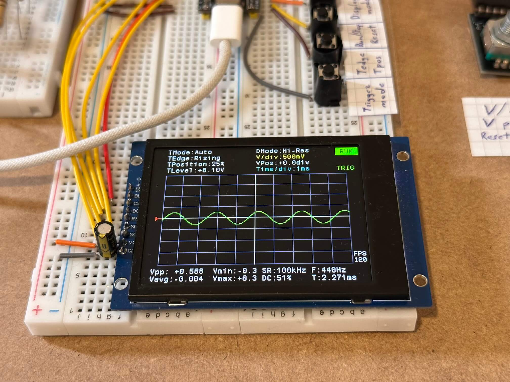
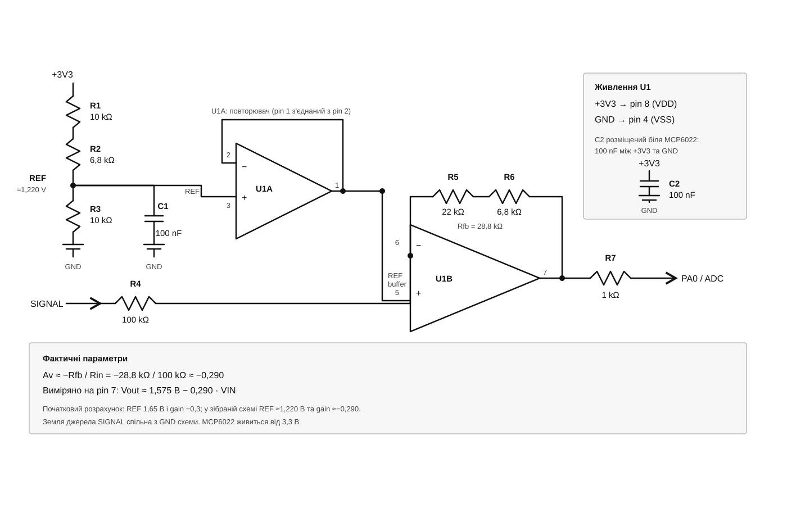
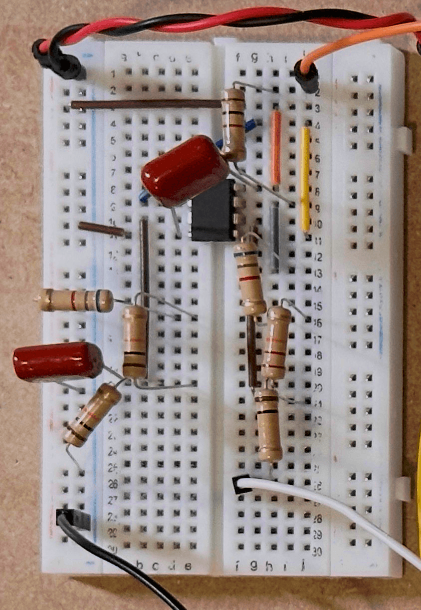
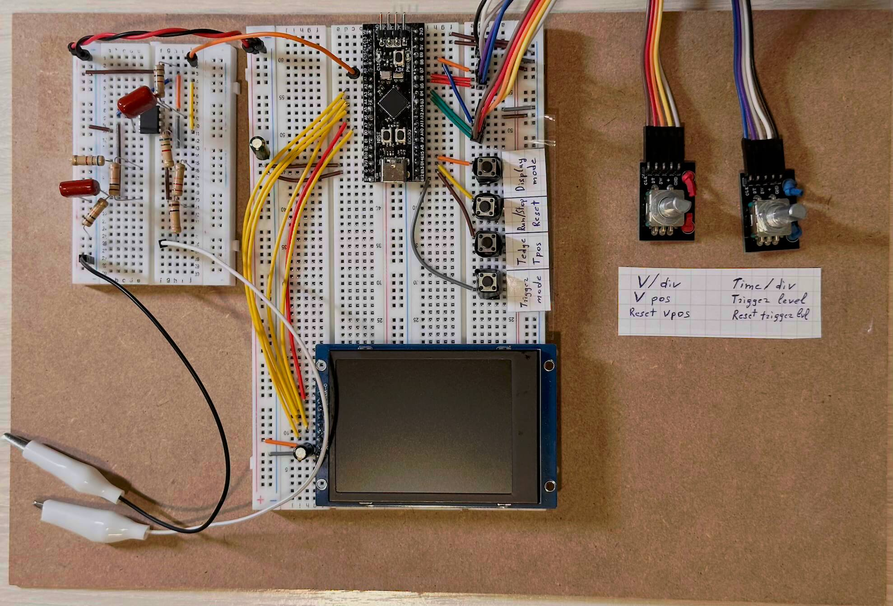

[Readme UA](README_UA.md) | [Readme EN](README.md) | [Demo](#demo)

# STM32 Oscilloscope

An embedded digital oscilloscope based on the STM32F401. The project reads an analog signal through the ADC, displays it on a ST7789 color display, and lets you adjust the scale, trigger mode, and trigger parameters using buttons and encoders.

## Features

- Signal display in **Sample**, **Peaks**, and **Hi-Res** modes.
- **Roll**, **Auto**, **Normal**, and **Single** trigger modes, with selectable edge and trigger position.
- Time scale from 200 us/div to 5 sec/div (sample rate from 20 Hz to 500 kHz) and voltage scale from 50 mV/div to 2 V/div.
- Vertical signal positioning and trigger level adjustment.
- VDDA measurement using the STM32 internal reference.
- Signal and performance statistics display.

## Hardware

The project is configured for an STM32F401, a 320×240 ST7789V display, and an analog input on **PA0 / ADC1_IN0**. Measuring a signal through PA0 requires an analog input stage: the configuration is designed for an external signal of approximately ±5 V, which the input stage scales and offsets to the ADC's valid range.

> **Caution:** Do not connect a negative voltage or a voltage outside the ADC input's allowed range directly to PA0. Connect the signal only through an appropriate protection and conditioning input stage. Measurement accuracy depends on its characteristics and calibration.

## Oscilloscope Input Stage · MCP6022

### Pin Assignments

| Function | STM32 Pins |
|---|---|
| Analog input | PA0 (ADC1_IN0) |
| ST7789 display, SPI1 | PA5 (SCK), PA7 (MOSI) |
| Display control | PA2 (DC), PA3 (RST), PA4 (CS), PA6 (BLK) |
| Buttons BTN_1–BTN_4 | PB12–PB15 |
| Encoder 1 | PB4, PB5; button — PB8 |
| Encoder 2 | PB6, PB7; button — PB9 |

The peripheral and pin configuration can also be viewed in [stm32-oscilloscope.ioc](stm32-oscilloscope.ioc).

## Controls

| Control | Action |
|---|---|
| BTN_1 | Switch trigger mode |
| BTN_2, short press | Switch trigger edge |
| BTN_2, long press | Change trigger position: 25%, 50%, or 75% |
| BTN_3, short press | Start or stop acquisition |
| BTN_3, long press | Reset settings |
| BTN_4, short press | Switch signal display mode |
| BTN_4, long press | Switch waveform drawing mode |
| Encoder 1 | Adjust V/div or vertical position |
| Encoder 1 button | Switch encoder mode; long press resets vertical position |
| Encoder 2 | Adjust Time/div or trigger level |
| Encoder 2 button | Switch encoder mode; long press resets trigger level |

## Development

The project was developed in VSCode using the stm32-vscode-extension and CMake 3.22.
An SWD-compatible programmer, such as an ST-LINK V2, was used for debugging the STM32.

## Demo

https://github.com/user-attachments/assets/ee0afcc1-41f9-4acb-b422-a945901ddf54

