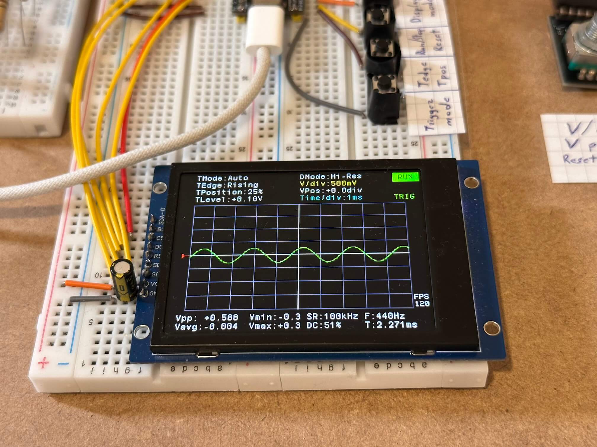
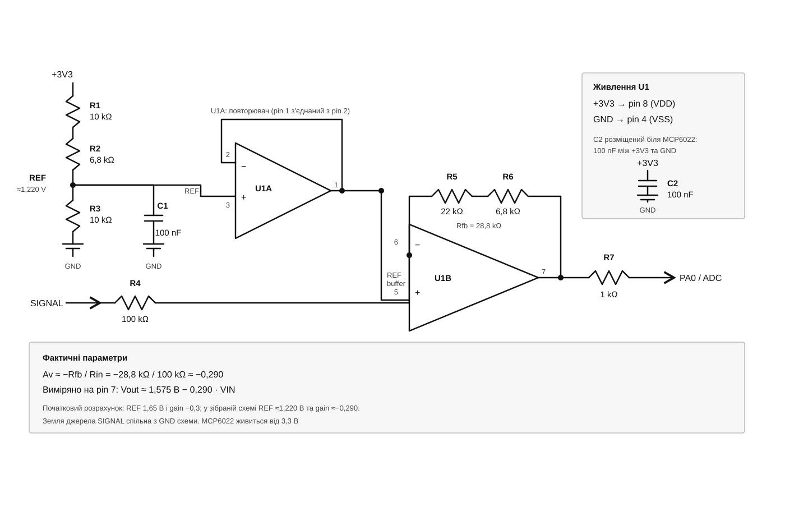
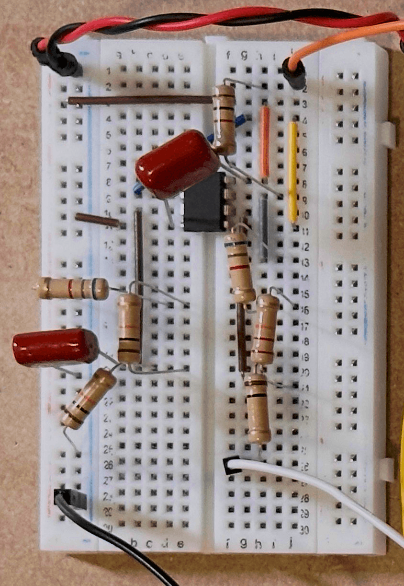
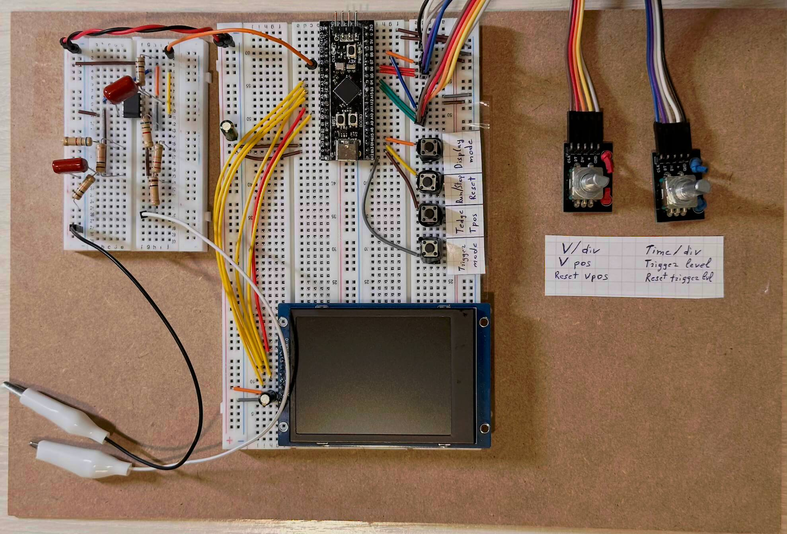

[Readme EN](README.md) | [Readme UA](README_UA.md)

# STM32-осцилограф

Вбудований цифровий осцилограф на базі STM32F401. Проєкт зчитує аналоговий сигнал через ADC, показує його на кольоровому дисплеї ST7789 та дає змогу змінювати масштаб, режим запуску й параметри тригера за допомогою кнопок і енкодерів.

## Можливості

- Відображення сигналу в режимах **Sample**, **Peaks** і **Hi-Res**.
- Режими тригера **Roll**, **Auto**, **Normal** і **Single**, вибір фронту та позиції тригера.
- Налаштування масштабу часу від 200 us/div до 5 sec/div (sample rate від 20 Hz до 500 kHz) та масштабу напруги від 50 mV/div до 2 V/div.
- Переміщення сигналу по вертикалі та налаштування рівня тригера.
- Вимірювання VDDA за внутрішнім опорним джерелом STM32.
- Відображення статистики сигналу та продуктивності.

## Апаратна частина

Проєкт налаштований для STM32F401, дисплея ST7789 з 320×240 та аналогового входу на **PA0 / ADC1_IN0**. Для вимірювання сигналу перед PA0 потрібен аналоговий вхідний каскад: конфігурація розрахована на зовнішній сигнал приблизно в межах ±5 В, який каскад масштабує та зміщує до допустимого діапазону ADC.

> **Увага:** не підключайте до PA0 безпосередньо від’ємну напругу або напругу поза допустимим діапазоном входу ADC. Підключайте сигнал лише через відповідний захисний та узгоджувальний вхідний каскад. Точність вимірювань залежить від його параметрів і калібрування.

## Вхідний каскад осцилографа · MCP6022

### Призначення виводів

| Функція | Виводи STM32 |
|---|---|
| Аналоговий вхід | PA0 (ADC1_IN0) |
| Дисплей ST7789, SPI1 | PA5 (SCK), PA7 (MOSI) |
| Керування дисплеєм | PA2 (DC), PA3 (RST), PA4 (CS), PA6 (BLK) |
| Кнопки BTN_1–BTN_4 | PB12–PB15 |
| Енкодер 1 | PB4, PB5; кнопка — PB8 |
| Енкодер 2 | PB6, PB7; кнопка — PB9 |

Конфігурацію периферії та контактів також можна переглянути у файлі [stm32-oscilloscope.ioc](stm32-oscilloscope.ioc).

## Керування

| Елемент | Дія |
|---|---|
| BTN_1 | Перемкнути режим тригера |
| BTN_2, коротке натискання | Перемкнути фронт тригера |
| BTN_2, довге натискання | Змінити позицію тригера: 25%, 50% або 75% |
| BTN_3, коротке натискання | Запустити або зупинити вимірювання |
| BTN_3, довге натискання | Скинути налаштування |
| BTN_4, коротке натискання | Перемкнути режим відображення сигналу |
| BTN_4, довге натискання | Перемкнути режим малювання хвиль |
| Енкодер 1 | Змінити V/div або вертикальне положення |
| Кнопка енкодера 1 | Перемкнути режим енкодера; довге натискання скидає вертикальне положення |
| Енкодер 2 | Змінити Time/div або рівень тригера |
| Кнопка енкодера 2 | Перемкнути режим енкодера; довге натискання скидає рівень тригера |

## Розробка

Проєкт робився в VSCode з stm32-vscode-extension, з використанням CMake 3.22.
Для дебагінгу з stm32, використовувався SWD-сумісний програматор, наприклад ST-LINK V2.

## Демонстрація

https://github.com/user-attachments/assets/ee0afcc1-41f9-4acb-b422-a945901ddf54

